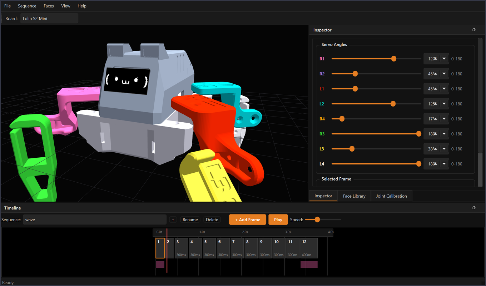
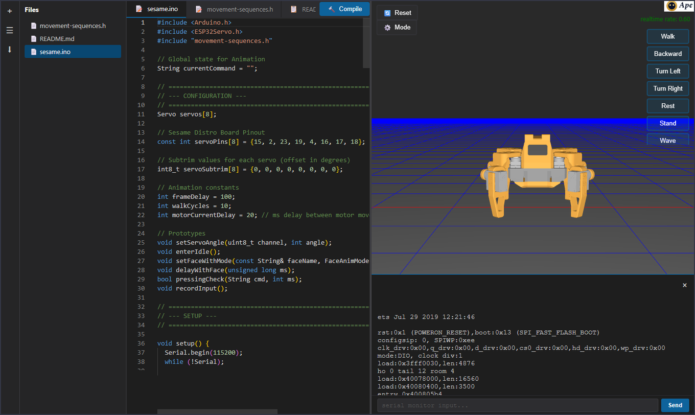
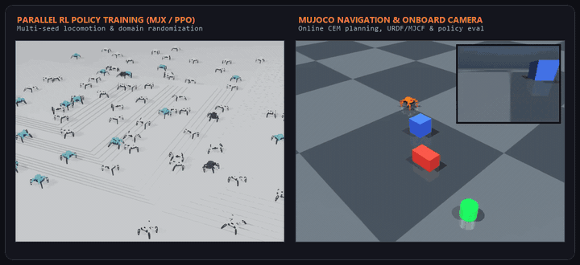
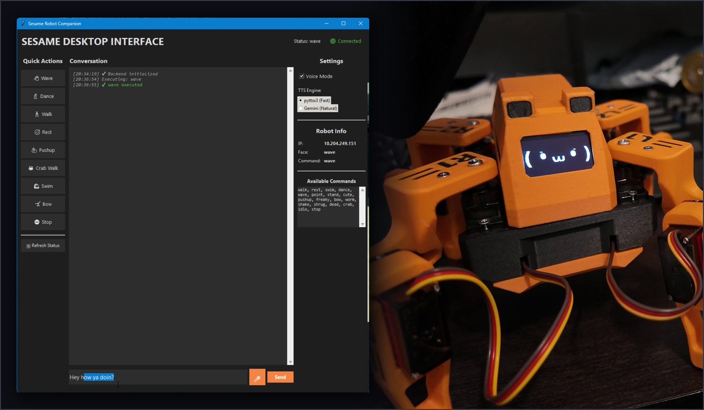

# Software

Software applications and simulation tools for making the most of your Sesame Robot.

## Tools

### [Sesame Studio](https://github.com/dorianborian/sesame-studio)
A PySide6-based animation, pose sequencing, and OLED face design tool.

- **3D Posable Viewport**: Real printed-part geometry, live-driven by servo angles, with joint calibration.
- **Timeline Editor**: Sequence, reorder, retime, and preview poses in real time.
- **Face Editor & Firmware Editor**: Paint 128x64 OLED expressions, or directly open, edit, and save Arduino `face-bitmaps.h` files with live hex preview.
- **Projects & Export**: Save/load `.sesproj` files, export firmware-ready code with an in-app integration guide.

**Note:** Sesame Studio is maintained in its own dedicated repository at [https://github.com/dorianborian/sesame-studio](https://github.com/dorianborian/sesame-studio).

[Go to Sesame Studio Repository ->](https://github.com/dorianborian/sesame-studio)

---

### [Sesame Simulator](https://one-for-all.github.io/sesame-robot-sim/)
A Rust-based 3D simulation environment created by Jay Li for testing Sesame's movements and kinematics directly in your browser.

- **Physics-based Simulation**: Test walking and balance without hardware.
- **Web-based Interface**: Edit firmware sequences and run the simulator directly in your browser.
- **URDF Integration**: Accurate modeling of Sesame's physical properties.

[Go to Sesame Simulator ->](https://one-for-all.github.io/sesame-robot-sim/)

---

### [Sesame ML Tools](https://github.com/lukehollis/sesame-ml)
ML tools created by Luke Hollis for Sesame, providing a world model for online planning, policy evaluation, and RL fine-tuning.

- **Robot Description**: Self-contained printable STLs, CAD-derived MJCF, validated URDF, camera/IMU/foot frames, primitive contact geometry, masses, and actuator limits.
- **Tasks**: Stand, challenged recovery, commanded locomotion, and goal/obstacle navigation.
- **Policy Evaluation**: Multi-seed JSON/CSV reports, strict task success, domain parameters, tracking/fall/collision/energy/latency metrics, MP4/GIF, and onboard/split views.

[Go to Sesame ML Repository ->](https://github.com/lukehollis/sesame-ml)

---

### [Sesame Companion App](https://github.com/dorianborian/sesame-companion-app)
A Python application for advanced robot control and interaction over your local network.

- **Voice Control**: Integrate with speech recognition for voice commands.
- **Emotion Mapping**: Automatically set robot expressions based on sentiment analysis.
- **Remote API Control**: Send commands and face changes via the JSON API.
- **Network Mode**: Requires robot firmware with network mode enabled.
- **Home Automation**: Example integrations with Home Assistant and other platforms.

**Note:** The Companion App is a separate repository and requires the latest firmware with network mode enabled.

[Go to Sesame Companion App Repository ->](https://github.com/dorianborian/sesame-companion-app)
